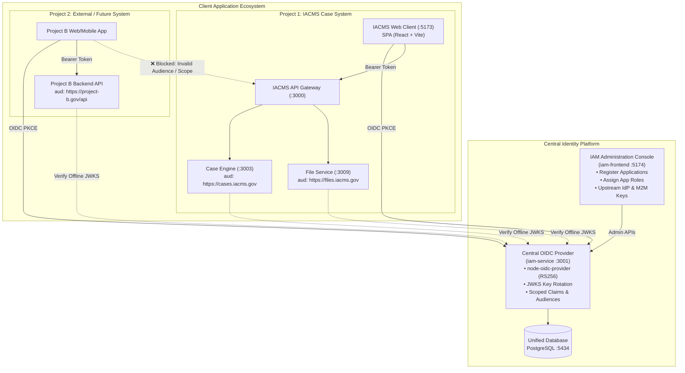

# Strategic Blueprint: Central Multi-Project Identity Provider (IdP) & IAM Architecture

## Executive Summary & Vision

The objective is to establish the `iam-service` as an enterprise-grade, centralized **Identity Provider (IdP) and OAuth 2.0 / OpenID Connect (OIDC) Authorization Server**. 

In this architecture:
1. **Central IAM as Source of Truth**: All identity management, credential storage, upstream federation (Google/Azure AD), and token minting are consolidated into `iam-service`.
2. **Decoupled Application Ecosystem**: The **IACMS Case Management System** is treated strictly as **Client Application #1**. Any subsequent internal or external system (**Project B**, **Project C**, partner agency portals, mobile field apps) connects as **Client Application #2, #3, etc.**
3. **Strict Cross-Project Boundary (Zero Trust)**: An identity authenticated for Project B **cannot** access IACMS Case APIs or data unless explicitly authorized for IACMS. Roles, permissions, audiences, and scopes are isolated per application.
4. **Dual-Tier Frontends**:
   - **`iam-frontend`**: Serves as the **Central IAM Developer & Administration Console** (similar to Keycloak Admin Console or Okta Admin Dashboard).
   - **`Client` / Project Apps**: End-user operational applications where caseworkers and staff execute their day-to-day domain workflows.

---

## Architecture Diagram



---

## Phased Implementation Plan

### Phase 1: Security Model & Multi-Project Role Isolation
> **Objective**: Eliminate cross-project privilege leakage so that roles and tokens granted for one project have zero authority in another.

#### 1.1 Application-Scoped Roles & Schema Evolution
* **Current Limitation**: In `schema.prisma`, `UserRole` assigns a global role to a user across the entire tenant. When a user requests a token with `scope=roles`, all assigned roles are returned without regard to which application requested the token.
* **Architecture Solution**:
  Evolve the role association model to bind roles to specific applications (`OAuthClient`):
  ```prisma
  model UserApplicationRole {
    id            String       @id @default(uuid()) @db.Uuid
    userId        String       @map("user_id") @db.Uuid
    oauthClientId String       @map("oauth_client_id") @db.Uuid
    roleId        String       @map("role_id") @db.Uuid
    createdAt     DateTime     @default(now()) @map("created_at")

    user          User         @relation(fields: [userId], references: [id], onDelete: Cascade)
    oauthClient   OAuthClient  @relation(fields: [oauthClientId], references: [id], onDelete: Cascade)
    role          Role         @relation(fields: [roleId], references: [id], onDelete: Cascade)

    @@unique([userId, oauthClientId, roleId])
    @@index([userId])
    @@index([oauthClientId])
    @@map("user_application_roles")
  }
  ```
  *Backwards Compatibility*: System/tenant administrator roles can remain tenant-global, while domain operational roles (`case_manager`, `project_b_analyst`) attach to their respective application.

#### 1.2 Contextual Token Claims Resolution (`find-account.js`)
* Update `findAccount(ctx, sub)`:
  - Extract the active `clientId` and requested `resource` (audience) from the OIDC context.
  - When embedding `roles`, query **only** the roles assigned to that user for the requesting `oauthClientId`.
  - Result: If User Alice logs in to Project B, her token contains only `roles: ['project_b_user']`. Her IACMS `case_manager` role is completely omitted.

#### 1.3 Strict Audience & Scope Enforcement (`verifyOAuthToken.js`)
* Enforce strict `audience` verification across all resource servers:
  - `case-engine-service` sets `audience: 'https://cases.iacms.gov/api'`
  - `file-service` sets `audience: 'https://files.iacms.gov/api'`
  - `project-b-service` sets `audience: 'https://project-b.gov/api'`
* If an access token issued to Project B is replayed against IACMS, `jose.jwtVerify` will immediately fail with `ERR_JWT_CLAIM_VALIDATION_FAILED` (mismatched audience).
* Enforce route-level `requireOAuthScope('cases:read')`.

---

### Phase 2: Modernizing the Central IAM Console (`iam-frontend`)
> **Objective**: Equip `iam-frontend` to serve as the unified administrative hub for multi-project governance.

#### 2.1 Project & Application Registry Hub
* Upgrade `ClientsPage` into an **Applications Hub**:
  - Distinguish application types: **Single Page App (SPA with PKCE)**, **Regular Web App (Confidential)**, and **Machine-to-Machine Service (M2M)**.
  - Configure permitted Redirect URIs, allowed scopes, and target API Resource Audiences per project.
  - Visual status indicators for client health and key rotation.

#### 2.2 Per-Project User Access Matrix (`UsersPage`)
* Upgrade `UsersPage` with granular access controls:
  - Add an **Application Access Tab** in the user inspection/edit modal.
  - Admins can explicitly check:
    - [x] **IACMS Case System** → Assigned Role: `Case Manager`
    - [x] **Project B Portal** → Assigned Role: `Viewer`
    - [ ] **Project C Financial Engine** → *No Access (Denied)*
  - One-click capability to suspend user access to a specific application without deleting their global identity.

#### 2.3 Tenant Admin Delegation
* Allow Tenant Administrators (`DCS-01`) to manage application integrations and user assignments within their tenant boundaries without requiring platform superadmin authority.

---

### Phase 3: Migrating the Main IACMS Client to Standard OIDC
> **Objective**: Transition the primary `Client` from legacy Redis session coupling into a clean OIDC client application.

#### 3.1 Register IACMS Client in the Central IdP
* Seed `OAuthClient` record:
  - `client_id: 'iacms_portal'`
  - `client_name: 'IACMS Case Management Portal'`
  - `grant_types: ['authorization_code', 'refresh_token']`
  - `response_types: ['code']`
  - `token_endpoint_auth_method: 'none'` (Public SPA with PKCE)
  - `redirect_uris: ['http://localhost:5173/auth/callback']`
  - `scope: 'openid profile email roles cases:read cases:create cases:update files:upload'`

#### 3.2 Implement PKCE Auth in `Client`
* In [`Client/src/lib/api.ts`](file:///home/elshu/code%20/IACMS/Client/src/lib/api.ts):
  - Replace the direct form `POST /api/v1/session/login` with an OIDC Authorization Code + PKCE redirect to `http://localhost:3001/oauth/authorize`.
  - Handle code exchange at `/auth/callback`.
  - Store tokens in memory / secure storage with silent refresh.
  - Implement OIDC End-Session RP-Initiated Logout (`/oauth/session/end`).

#### 3.3 Gateway Dual-Mode Support
* The API Gateway supports both existing session cookies (for non-migrated micro-endpoints) and Bearer tokens for all `/api/v1/*` routes, validating standard JWTs and passing downstream headers.

---

### Phase 4: Verification Suite & "Project B" Reference Template
> **Objective**: Validate the full end-to-end multi-project ecosystem and prove complete isolation.

#### 4.1 "Project B" Mock Reference Integration
* Create a minimal external service and client representing "Project B" (`project_b_client`, audience: `https://project-b.gov/api`).

#### 4.2 Automated Security & Isolation Test Matrix
| Test Case | Scenario | Expected Outcome |
| :--- | :--- | :--- |
| **T1: Normal Login** | User logs into IACMS with valid credentials | Receives token with `aud: https://cases.iacms.gov`, access granted to Case Engine |
| **T2: Cross-Project Denial** | User logs into Project B, receives token, attempts to call `GET /cases` | **401 Unauthorized / 403 Forbidden** (`ERR_JWT_AUDIENCE_MISMATCH` or `insufficient_scope`) |
| **T3: Multi-App User** | User has role `supervisor` in IACMS and `viewer` in Project B | Token for IACMS has only `supervisor`; token for Project B has only `viewer` |
| **T4: Per-App Revocation** | Admin revokes user from Project B in `iam-frontend` | User is immediately denied on Project B; IACMS session remains active and valid |
| **T5: M2M Key Isolation** | API key issued for Project B sent to IACMS File Service | Request rejected due to unauthorized audience/scope |

---

## Deliverables & Milestones Summary

```
Phase 1: Security Model & Role Isolation  ──► DB Schema Migration & Token Scoping
Phase 2: Central IAM Console              ──► Applications Hub & Per-Project Access Matrix
Phase 3: Main Client OIDC Migration       ──► PKCE Flow & Gateway Bearer Validation
Phase 4: Reference App & Verification     ──► Automated Isolation Testing & Documentation
```
